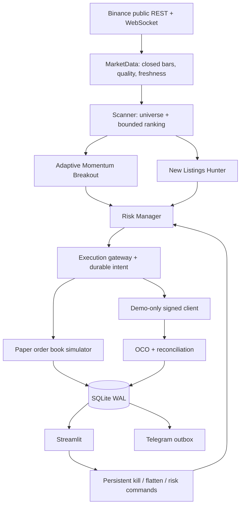

# Binance Smart Trader: архитектура

Проект использует один процесс исполнения и отдельный процесс Streamlit. Python 3.12+.
Ни класс режима, ни CLI, ни адаптер брокера не предоставляют реальную торговлю.

## Последовательность

1. Первый запуск фиксирует конфигурацию, виртуальный бюджет 10 000 USDT и снимок universe.
2. REST `exchangeInfo`, `ticker/24hr`; отбор всех разрешённых USDT Spot символов.
3. Закрытые свечи 1H / 15M, целостность, BTC regime, стакан, нормированный рейтинг.
4. Стратегия возвращает только сигнал. Gateway повторно получает свежий стакан, Risk Manager
   рассчитывает количество, округляет Decimal, проверяет издержки, корреляцию и общие лимиты.
5. SQLite сохраняет уникальный intent до отправки. Детерминированные client IDs. Неопределённый
   POST никогда автоматически не повторяется, даже если последующий GET вернул «не найдено».
6. DEMO: исполненные покупки сверяются с `myTrades` (включая комиссии в базовом активе).
   Подтверждается OCO `TAKE_PROFIT` / `STOP_LOSS`, обе ветки рыночные после срабатывания.
   Если защиты нет: остановка входов, отмена известных ордеров, подтверждение отмены и
   закрытие остатка. Неопределённость сохраняется в БД и разбирается при следующем проходе.
7. PAPER: частичное IOC исполнение по реальной глубине с ограничением участия, дополнительным
   проскальзыванием и комиссиями; stop/target обслуживаются непрерывным монитором.
8. Kill switch блокирует входы, монитор продолжает работать. Отдельный flatten отменяет
   защиту и закрывает позиции. При недоступном API нельзя гарантировать немедленное закрытие.

## Состояние и восстановление

SQLite хранит intents, raw order responses, ledger позиций/сделок, капитал, снимки символов,
причины решений, настройки, команды и Telegram outbox. Один системный lock запрещает два
исполнителя с одной БД. После рестарта DEMO сначала сверяет все сохранённые intents и
собственные открытые ордера; неизвестные ордера с префиксом бота блокируют новые входы.
PAPER после простоя закрывает по доступной цене, без выдуманного ретроактивного исполнения.

## Исследование

Бэктест последовательно воспроизводит закрытые 15M бары, вход на следующем open, 1H строится
из завершённых 15M. Общий Risk Manager и общие сигналы; дневные/недельные equity limits.
Если stop и target попали в один бар, stop считается первым. Исторические bid/ask и глубина
не восстанавливаются из OHLCV: требуется явное разрешение модельных предположений.
Universe manifest может описывать листинг/делистинг и интервалы TRADING; данные текущего
exchangeInfo не объявляются историческим составом рынка. Walk-forward выбирает параметры
только на train и оценивает на следующем непересекающемся test. Сводка предупреждает о малой
выборке. Форвард-наблюдение не менее 30–60 дней остаётся обязательным этапом исследования.
